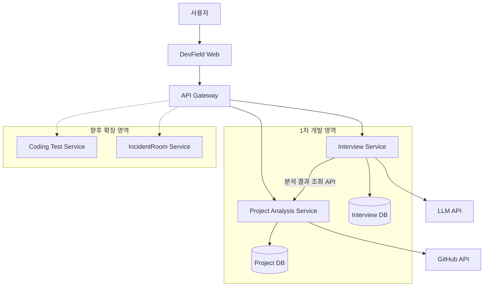

 

# DevField

### Practice. Solve. Grow.

**개발자의 실력을 키우고 증명하는 공간**

AI 기술면접부터 코딩테스트, 실무 장애 대응 훈련까지

개발자의 기술적 이해도와 실무 문제 해결 능력을 성장시키는 플랫폼

---

## About DevField

**DevField**는 개발자가 자신의 기술적 이해도와 문제 해결 능력을 실전과 유사한 환경에서 훈련하고 검증할 수 있도록 설계하는 **MSA 기반 개발자 역량 강화 플랫폼**입니다.

GitHub 프로젝트 기반 AI 기술면접을 시작으로, 코딩테스트와 실무 장애 대응 훈련까지 독립적인 서비스를 단계적으로 확장하는 것을 목표로 합니다.

단순한 지식 암기를 넘어 **기술을 이해하고, 직접 문제를 해결하며, 자신의 선택과 구현을 설명할 수 있는 역량**에 집중합니다.

## Project Background

개발자 및 엔지니어 취업을 준비하면서, 기존의 CS·기술면접 기출문제만으로는 **직접 수행한 프로젝트에 대한 심층적인 기술면접**을 대비하기 어렵다는 한계를 느꼈습니다.

특히 **"왜 이 기술을 선택했는가?"**, **"왜 이러한 구조로 설계했는가?"**와 같은 질문과 이어지는 꼬리질문에 대비하기 위해서는 실제 프로젝트를 기반으로 한 맞춤형 면접 훈련이 필요하다고 생각했습니다.

이에 **GitHub 프로젝트를 AI가 분석하여 맞춤형 기술 질문과 꼬리질문을 생성하고, 답변을 평가하는 서비스**를 기획하게 되었습니다.

나아가 인프라·클라우드 엔지니어링 분야의 실무 장애 대응 훈련과 코딩테스트까지 확장하여, **개발자의 다양한 기술 역량을 종합적으로 훈련할 수 있는 플랫폼**으로 발전시키고자 합니다.

---

## Our Services

DevField는 각 서비스를 독립적으로 개발·운영하며, 사용자가 필요한 훈련을 자유롭게 선택할 수 있는 플랫폼을 지향합니다.

### 01. AI Technical Interview

> **현재 우선 개발 대상**

GitHub 프로젝트를 분석하여 실제 개발 경험과 기술적 의사결정 능력을 검증하는 **AI 기반 맞춤형 기술면접 서비스**입니다.

**주요 기능 목표**

- GitHub 저장소 및 소스 코드·문서 분석
- 프로젝트 기반 맞춤형 기술 질문 생성
- AI 모의면접 및 답변에 따른 꼬리질문
- 기술적 정확성 및 설명 능력 평가
- 맞춤형 피드백 및 면접 이력 관리

### 02. Coding Test

> **향후 확장 예정**

알고리즘과 자료구조를 중심으로 코딩 문제 해결 능력을 훈련하는 서비스입니다.

**주요 기능 목표**

- 알고리즘 및 자료구조 문제 제공
- 코드 작성·실행 및 자동 채점
- 풀이 결과 및 학습 이력 관리

### 03. IncidentRoom

> **향후 확장 예정**

실제 운영 환경을 가정한 장애 시나리오에서 원인을 분석하고 대응하는 **인프라·시스템 실무형 훈련 서비스**입니다.

**주요 기능 목표**

- 가상 인프라·시스템 장애 시나리오 제공
- 로그 및 메트릭 기반 장애 원인 분석
- 장애 대응 실습 및 문제 해결 과정 평가
- AI 기반 대응 피드백

---

## Architecture & Engineering

DevField는 **Microservices Architecture(MSA)**와 **Multi-Repository** 구조를 기반으로 설계합니다.

각 서비스는 독립적인 책임과 데이터 소유권을 가지며, 개별적으로 개발·배포·확장할 수 있는 구조를 지향합니다.

### System Architecture

> 위 다이어그램은 초기 논리 아키텍처로, 서비스별 세부 구성과 통신 방식은 설계 과정에서 구체화할 예정입니다. 점선은 향후 확장 영역을 나타냅니다.

### Core Principles

- **Service Independence** — 서비스별 책임과 기능 분리
- **Independent Deployment** — 서비스별 독립적인 빌드·테스트·배포
- **Data Ownership** — 서비스별 데이터 소유권과 접근 경계 분리
- **API-Driven Communication** — 명시적인 API 계약 기반 통신
- **Scalability** — 새로운 서비스의 독립적인 확장
- **Observability** — 서비스 상태 및 장애 추적 체계 구축

각 서비스는 독립적으로 이용할 수 있도록 설계하며, 공통 플랫폼을 통해 일관된 사용자 경험을 제공하는 것을 목표로 합니다.

구체적인 기술 스택과 인프라 구성은 요구사항 및 아키텍처 설계 과정에서 확정합니다.

---

## Development Roadmap

| 단계 | 주요 목표 | 상태 |
|:---:|---|:---:|
| 1 | 프로젝트 요구사항 및 MSA 아키텍처 설계 | 진행 중 |
| 2 | GitHub 프로젝트 수집·분석 기능 개발 | 예정 |
| 3 | AI 기술면접 및 답변 평가 기능 개발 | 예정 |
| 4 | 통합 테스트 및 서비스별 배포 환경 구축 | 예정 |
| 5 | Coding Test 서비스 확장 | 장기 계획 |
| 6 | IncidentRoom 서비스 확장 | 장기 계획 |

일정과 개발 범위는 프로젝트 진행 상황에 따라 조정될 수 있습니다.

---

### DevField

**Practice. Solve. Grow.**

기술을 이해하고, 문제를 해결하며, 실력을 증명하는 공간.

[GitHub Organization](https://github.com/thedevfield)

